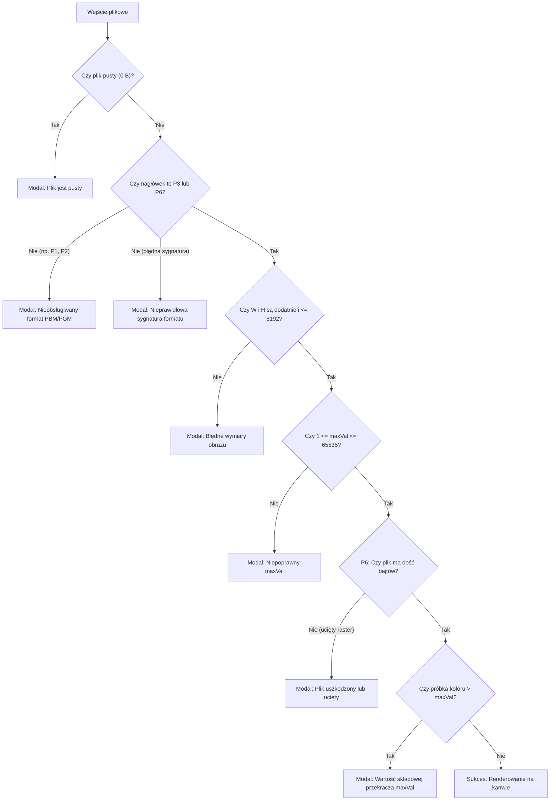

# Kompendium Wiedzy i Dokumentacja Implementacji Formatu PPM (Netpbm) w Projekcie Paint

Niniejszy dokument stanowi kompletne, techniczne i dydaktyczne omówienie formatu **PPM (Portable Pixmap)** oraz jego pełnej implementacji w edytorze graficznym **GK Paint**. Został przygotowany tak, aby umożliwić szczegółowe omówienie projektu „linijka po linijce” podczas obrony laboratoryjnej u prowadzącej.

---

## Spis Treści
1. [Istota formatu PPM (Portable Pixmap)](#1-istota-formatu-ppm-portable-pixmap)
2. [Anatomia i struktura pliku PPM (P3 vs P6)](#2-anatomia-i-struktura-pliku-ppm-p3-vs-p6)
3. [Architektura potoku danych (Transplantacja formatów)](#3-architektura-potoku-danych-transplantacja-formatów)
4. [Struktura plików w projekcie i podział odpowiedzialności](#4-struktura-plików-w-projekcie-i-podział-odpowiedzialności)
5. [Szczegółowa analiza kodu źródłowego (Linijka po linijce)](#5-szczegółowa-analiza-kodu-źródłowego-linijka-po-linijce)
   - [5.1. Parser i Enkoder: `js/ppm.js`](#51-parser-i-enkoder-jsppmjs)
   - [5.2. Akcje plikowe i I/O: `js/fileActions.js`](#52-akcje-plikowe-i-io-jsfileactionsjs)
   - [5.3. Interfejs i zdarzenia: `js/ui.js`](#53-interfejs-i-zdarzenia-jsuijs)
   - [5.4. Płótno i stan: `js/canvas.js` oraz `js/state.js`](#54-płótno-i-stan-jscanvasjs-oraz-jsstatejs)
6. [Zdarzenia i interakcje użytkownika (Na co reaguje system)](#6-zdarzenia-i-interakcje-użytkownika-na-co-reaguje-system)
7. [Obsługa błędów, walidacja i przypadki brzegowe](#7-obsługa-błędów-walidacja-i-przypadki-brzegowe)
8. [Ściąga do obrony u Prowadzącej (Pytania i Gotowe Odpowiedzi)](#8-ściąga-do-obrony-u-prowadzącej-pytania-i-gotowe-odpowiedzi)

---

## 1. Istota formatu PPM (Portable Pixmap)

Format **PPM** należy do rodziny formatów **Netpbm** (obok PBM dla grafiki 1-bitowej i PGM dla odcieni szarości). Został zaprojektowany jako uniwersalny, najprostszy możliwy format wymiany barwnych danych rastrowych pomiędzy różnymi platformami.

### Kluczowe cechy formatu:
- **Brak kompresji:** Dane są zapisywane w postaci nieskompresowanej – piksel po pikselu, od lewej do prawej, od góry do dołu.
- **Brak kanału przezroczystości (Alfa):** Format przechowuje wyłącznie składowe barwne **R (Red)**, **G (Green)** oraz **B (Blue)**.
- **Dwa warianty reprezentacji:**
  - **P3 (ASCII / Plain):** Dane zapisane czytelnym dla człowieka tekstem w kodowaniu ASCII (liczby dziesiętne rozdzielone białymi znakami).
  - **P6 (Raw / Binary):** Nagłówek tekstowy w ASCII, po którym następuje strumień surowych bajtów binarnych.
- **Elastyczna dynamika barw (`maxVal`):** Maksymalna wartość składowej koloru nie musi wynosić 255 – może to być dowolna liczba całkowita z zakresu $1 \le \text{maxVal} \le 65535$. Wartości powyżej 255 kodowane są 16-bitowo (Big-Endian).

---

## 2. Anatomia i struktura pliku PPM (P3 vs P6)

Każdy poprawny plik PPM składa się z dwóch głównych sekcji: **Nagłówka (Header)** oraz **Danych Rastrowych (Raster Data)**.

### 2.1. Nagłówek PPM
Nagłówek składa się z 4 logicznych pól, rozdzielonych białymi znakami (spacje, tabulatory, znaki nowego wiersza LF `\n` lub CRLF `\r\n`):

1. **Sygnatura (Magic Number):**
   - `"P3"` – PPM w postaci tekstowej (ASCII).
   - `"P6"` – PPM w postaci binarnej (surowe bajty).
2. **Szerokość (Width):** Dodatnia liczba całkowita określająca liczbę kolumn pikseli.
3. **Wysokość (Height):** Dodatnia liczba całkowita określająca liczbę wierszy pikseli.
4. **Maksymalna wartość próbki (`maxVal`):** Dodatnia liczba całkowita określająca zakres intensywności każdej składowej barwnej (od $0$ do $\text{maxVal}$). Najczęściej jest to `255`.

> **Zasada komentarzy w nagłówku:** W dowolnym miejscu nagłówka (przed, pomiędzy lub za polami) może pojawić się znak `#`. Wszystkie znaki od `#` do końca bieżącej linii są traktowane jako komentarz i muszą zostać zignorowane przez parser, ale w naszym projekcie są one dodatkowo kolekcjonowane i prezentowane użytkownikowi!

---

### 2.2. Porównanie wariantów P3 i P6

#### Wariant P3 (Tekstowy / ASCII)
```text
P3
# Przykładowy obraz 2x2 piksele
2 2
255
255 0 0     0 255 0
0 0 255     255 255 255
```
- Wszystkie liczby zapisane są znakami ASCII `'0'`–`'9'`.
- Komentarze (`#`) mogą pojawiać się **nawet wewnątrz strumienia pikseli**.
- Zgodnie ze specyfikacją Netpbm: żaden wiersz pliku P3 nie powinien przekraczać **70 znaków**.

#### Wariant P6 (Binarny / Raw)
```text
P6
# Obraz 2x1 piksel
2 1
255
[BAJT_SEPARATORA][R1][G1][B1][R2][G2][B2]
```
- Nagłówek jest tekstowy.
- **Kluczowy detal standardu Netpbm:** Bezpośrednio po liczbie `maxVal` musi wystąpić **dokładnie jeden biały znak** (najczęściej `\n` lub spacja), który pełni rolę separatora nagłówka od rastra.
- Zaraz po tym jednym bajcie rozpoczynają się surowe bajty pikseli.
- **W rastrze P6 nie wolno pomijać białych znaków ani szukać komentarzy `#`!** Dlaczego? Ponieważ bajt o wartości `32` (spacja), `10` (`\n`) czy `35` (`#`) może być faktyczną wartością składowej koloru (np. ciemnoczerwony piksel o barwie `R=35, G=9, B=32`).

---

## 3. Architektura potoku danych (Transplantacja formatów)

```mermaid
flowchart TD
    subgraph ODCZYT_IMPORT [Potok Importu PPM]
        A["Plik dyskowy (.ppm)"] -->|"FileReader.readAsArrayBuffer()"| B["ArrayBuffer"]
        B -->|"Widok bajtowy"| C["Uint8Array"]
        C -->|"PaintPPM.parse()"| D["Dekodowanie nagłówka (P3/P6, W, H, maxVal, #)"]
        D -->|"Skalowanie (scale = 255 / maxVal) + A=255"| E["ImageData (Uint8ClampedArray: RGBA)"]
        E -->|"mainCtx.putImageData()"| F["HTML5 Canvas (Płótno robocze)"]
    end

    subgraph ZAPIS_EKSPORT [Potok Eksportu PPM]
        G["HTML5 Canvas (Płótno robocze)"] -->|"mainCtx.getImageData()"| H["ImageData (Uint8ClampedArray: RGBA)"]
        H -->|"PaintPPM.encodeP6() / encodeP3()"| I["Mieszanie z białym tłem dla Alfa < 255 + Formatowanie"]
        I -->|"new Blob([nagłówek, raster], type: image/x-portable-pixmap)"| J["Blob"]
        J -->|"URL.createObjectURL(blob)"| K["Pobranie pliku przez przeglądarkę"]
    end
```

Przeglądarka internetowa i element HTML5 `<canvas>` nie potrafią natywnie renderować plików PPM (w przeciwieństwie do PNG czy JPEG). Z tego względu cały proces odczytu i zapisu opiera się na **transplantacji danych**:



### Na czym polega transplantacja do formatu wewnętrznego (`ImageData`)?
1. **Model pamięci przeglądarki (`ImageData`):**
   Przeglądarka przechowuje piksele w jednowymiarowej tablicy typowanej [`Uint8ClampedArray`](file:///c:/Users/cyunc/Documents/Projects/PAINT/js/ppm.js#L212), gdzie każdy piksel zajmuje **4 bajty**:
   $$\text{Piksel}_i = [\text{R}_i, \text{G}_i, \text{B}_i, \text{A}_i]$$
   - $\text{R}, \text{G}, \text{B}$ w zakresie $0–255$,
   - $\text{A}$ (kanał przezroczystości Alfa) w zakresie $0–255$ ($255 = \text{pełne krycie}$).
2. **Krok transplantacji przy imporcie:**
   - Z pliku PPM odczytujemy trójki $[R, G, B]$.
   - Jeśli $\text{maxVal} \neq 255$, przeliczamy próbkę wzorem:
     $$R_{8} = \min\left(255, \operatorname{round}\left(R \cdot \frac{255}{\text{maxVal}}\right)\right)$$
   - Zapisujemy do `ImageData`:
     `rgba[dstIdx] = R8; rgba[dstIdx+1] = G8; rgba[dstIdx+2] = B8; rgba[dstIdx+3] = 255;`
   - Kanał Alfa ustawiamy na sztywno na $255$ (pełne krycie), ponieważ PPM nie ma przezroczystości.
3. **Krok transplantacji przy eksporcie:**
   - Z `ImageData` bierzemy czwórki $[R, G, B, A]$.
   - Jeśli piksel na płótnie posiada przezroczystość ($A < 255$), dokonujemy **kompozycji alfa z białym tłem** ($RGB = 255, 255, 255$):
     $$C_{\text{wyjściowe}} = \operatorname{round}\left(C \cdot \alpha + 255 \cdot (1 - \alpha)\right), \quad \text{gdzie } \alpha = \frac{A}{255}$$
   - Dzięki temu użytkownik nie traci czytelności rysunku po zapisie do formatu bezobsługowego dla kanału alfa.

---

## 4. Struktura plików w projekcie i podział odpowiedzialności

Projekt został podzielony na modularne pliki w katalogu [`js/`](file:///c:/Users/cyunc/Documents/Projects/PAINT/js):

| Plik | Klasa / Obiekt | Główna odpowiedzialność |
| :--- | :--- | :--- |
| [`js/ppm.js`](file:///c:/Users/cyunc/Documents/Projects/PAINT/js/ppm.js) | `window.PaintPPM`, `PPMError` | **Serce obsługi PPM:** Niezależny, czysty parser i enkoder P3 oraz P6. Zero zależności od DOM, operuje wyłącznie na `ArrayBuffer`, `Uint8Array`, `ImageData` i `Blob`. |
| [`js/fileActions.js`](file:///c:/Users/cyunc/Documents/Projects/PAINT/js/fileActions.js) | `window.PaintFiles` | **Operacje I/O i integracja:** Odczyt plików z dysku (`FileReader`), detekcja sygnatur, orkiestracja wczytywania na płótno, obsługa okna zapisu, wywoływanie pobierania pliku (`Blob` $\to$ `<a> download`). |
| [`js/ui.js`](file:///c:/Users/cyunc/Documents/Projects/PAINT/js/ui.js) | `window.PaintUI` | **Interakcja z użytkownikiem:** Obsługa zdarzeń kliknięć, skrótów klawiszowych (`Ctrl+O`, `Ctrl+S`, `Escape`), obsługa Drag and Drop, modale błędów, informacji o pliku i zapisu. |
| [`js/canvas.js`](file:///c:/Users/cyunc/Documents/Projects/PAINT/js/canvas.js) | `window.PaintCanvas` | **Obsługa płótna HTML5:** Zmiana wymiarów (`setDimensions`), dopasowanie zoomu do małych/dużych obrazów (`fitToScreen`), zarządzanie kontekstami `mainCtx` i `overlayCtx`. |
| [`js/state.js`](file:///c:/Users/cyunc/Documents/Projects/PAINT/js/state.js) | `window.PaintState` | **Magazyn stanu:** Przechowywanie metadanych aktualnie otwartego pliku (`currentFileInfo`: nazwa, typ, wymiary, `maxVal`, komentarze). |
| [`tests/ppm.test.js`](file:///c:/Users/cyunc/Documents/Projects/PAINT/tests/ppm.test.js) | Test Runner Node.js | **Zautomatyzowane testy:** 12 testów jednostkowych weryfikujących wszystkie wymagania, przypadki brzegowe i błędy. |
| [`tests/index.html`](file:///c:/Users/cyunc/Documents/Projects/PAINT/tests/index.html) | Przeglądarkowy runner testów | Wizualna weryfikacja testów jednostkowych w oknie przeglądarki. |

---

## 5. Szczegółowa analiza kodu źródłowego (Linijka po linijce)

### 5.1. Parser i Enkoder: [`js/ppm.js`](file:///c:/Users/cyunc/Documents/Projects/PAINT/js/ppm.js)

#### Klasa błędu [`PPMError`](file:///c:/Users/cyunc/Documents/Projects/PAINT/js/ppm.js#L19-L24)
```javascript
class PPMError extends Error {
  constructor(message) {
    super(message);
    this.name = 'PPMError';
  }
}
```
- **Dlaczego?** Pozwala jednoznacznie odróżnić błędy logiczne formatu PPM (nieprawidłowy nagłówek, ucięty plik, przekroczenie `maxVal`) od standardowych błędów silnika JavaScript (np. brak pamięci, błąd sieci).

---

#### Funkcja pomocnicza [`readCommentLine`](file:///c:/Users/cyunc/Documents/Projects/PAINT/js/ppm.js#L34-L51)
```javascript
function readCommentLine(buffer, state, commentsList = null) {
  state.offset++; // Pomiń znak '#'
  const commentStart = state.offset;
  const len = buffer.length;
  while (state.offset < len && buffer[state.offset] !== 10 && buffer[state.offset] !== 13) {
    state.offset++;
  }
  if (commentsList) {
    let commentText = '';
    for (let i = commentStart; i < state.offset; i++) {
      commentText += String.fromCharCode(buffer[i]);
    }
    const trimmed = commentText.trim();
    if (trimmed.length > 0) {
      commentsList.push(trimmed);
    }
  }
}
```
- **Linia 35:** Pomija znak `#` (kod ASCII 35).
- **Linie 38–40:** Przewija wskaźnik `state.offset` do przodu, dopóki nie natrafi na znak nowej linii (LF: 10 lub CR: 13) albo koniec bufora.
- **Linie 41–50:** Jeśli przekazano tablicę `commentsList`, odczytuje znaki komentarza, usuwa zbędne białe znaki (`trim()`) i zapisuje treść w tablicy metadanych.

---

#### Funkcja pomocnicza [`skipWhitespaceAndComments`](file:///c:/Users/cyunc/Documents/Projects/PAINT/js/ppm.js#L60-L80)
```javascript
function skipWhitespaceAndComments(buffer, state, commentsList = null) {
  const len = buffer.length;
  while (state.offset < len) {
    const b = buffer[state.offset];

    // Białe znaki: spacja (32), tab (9), LF (10), VT (11), FF (12), CR (13)
    if (b === 32 || b === 9 || b === 10 || b === 11 || b === 12 || b === 13) {
      state.offset++;
      continue;
    }

    // Komentarz: kod ASCII 35 to znak '#'
    if (b === 35) {
      readCommentLine(buffer, state, commentsList);
      continue;
    }

    // Napotkano początek właściwego tokenu
    break;
  }
}
```
- Pomija wszelkie białe znaki w nagłówku oraz całe linie komentarzy. Obsługuje dowolne kombinacje Windows CRLF (`\r\n`), Unix LF (`\n`) oraz wielokrotne spacje.

---

#### Funkcja pomocnicza [`readToken`](file:///c:/Users/cyunc/Documents/Projects/PAINT/js/ppm.js#L89-L107)
```javascript
function readToken(buffer, state, commentsList = null) {
  skipWhitespaceAndComments(buffer, state, commentsList);
  if (state.offset >= buffer.length) return null;

  const start = state.offset;
  while (state.offset < buffer.length) {
    const b = buffer[state.offset];
    if (b === 32 || b === 9 || b === 10 || b === 11 || b === 12 || b === 13 || b === 35) {
      break;
    }
    state.offset++;
  }

  let token = '';
  for (let i = start; i < state.offset; i++) {
    token += String.fromCharCode(buffer[i]);
  }
  return token;
}
```
- Służy do odczytania sygnatury pliku (`P3` lub `P6`). Pobiera znaki aż do pierwszego białego znaku lub komentarza.

---

#### Zoptymalizowana funkcja [`readInt`](file:///c:/Users/cyunc/Documents/Projects/PAINT/js/ppm.js#L117-L143)
```javascript
function readInt(buffer, state, commentsList = null) {
  skipWhitespaceAndComments(buffer, state, commentsList);
  if (state.offset >= buffer.length) return null;

  let val = 0;
  let hasDigits = false;
  while (state.offset < buffer.length) {
    const b = buffer[state.offset];
    if (b >= 48 && b <= 57) { // Kody ASCII '0'..'9'
      val = val * 10 + (b - 48);
      hasDigits = true;
      state.offset++;
    } else {
      break;
    }
  }

  if (!hasDigits) {
    while (state.offset < buffer.length && buffer[state.offset] > 32 && buffer[state.offset] !== 35) {
      state.offset++;
    }
    return NaN;
  }

  return val;
}
```
- **Kluczowa optymalizacja silnika V8:** Zamiast tworzyć stringi przez `substring()` i wywoływać `parseInt()`, funkcja przelicza liczbę bezalokacyjnie bezpośrednio z kodów ASCII: `val = val * 10 + (b - 48)`. Pozwala to na błyskawiczne wczytanie nawet wielomegapikselowych plików P3 bez zapychania Garbage Collectora.

---

#### Główna metoda parsowania: [`PaintPPM.parse(arrayBuffer)`](file:///c:/Users/cyunc/Documents/Projects/PAINT/js/ppm.js#L153-L366)

##### Krok 1: Weryfikacja bufora i sygnatury ([linie 154–176](file:///c:/Users/cyunc/Documents/Projects/PAINT/js/ppm.js#L154-L176))
```javascript
if (!arrayBuffer || arrayBuffer.byteLength === 0) {
  throw new PPMError('Plik jest pusty (0 bajtów).');
}
const buffer = new Uint8Array(arrayBuffer);
const state = { offset: 0 };
const comments = [];

const magic = readToken(buffer, state, comments);
if (!magic) {
  throw new PPMError('Plik jest zbyt krótki: nie znaleziono sygnatury pliku w nagłówku.');
}
if (magic !== 'P3' && magic !== 'P6') {
  if (magic === 'P1' || magic === 'P4') {
    throw new PPMError(`Nieobsługiwany format: ${magic} (obraz czarno-biały PBM)...`);
  }
  if (magic === 'P2' || magic === 'P5') {
    throw new PPMError(`Nieobsługiwany format: ${magic} (obraz w odcieniach szarości PGM)...`);
  }
  throw new PPMError(`Nieprawidłowa sygnatura formatu: "${magic}"...`);
}
```
- Zabezpieczenie przed pustym plikiem.
- Precyzyjne rozpoznanie formatów PBM (`P1`/`P4`) i PGM (`P2`/`P5`) oraz wyświetlenie dedykowanego komunikatu dydaktycznego zamiast generycznego błędu.

##### Krok 2 i 3: Wymiary obrazu ([linie 179–200](file:///c:/Users/cyunc/Documents/Projects/PAINT/js/ppm.js#L179-L200))
```javascript
const width = readInt(buffer, state, comments);
// Walidacja czy width to liczba dodatnia...
const height = readInt(buffer, state, comments);
// Walidacja czy height to liczba dodatnia...
if (width > 8192 || height > 8192) {
  throw new PPMError(`Wymiary obrazu (${width} × ${height}) przekraczają maksymalny dopuszczalny limit kanwy (8192 px).`);
}
```
- Zapobiega atakom typu Denial of Service / wyczerpaniu pamięci RAM przy złośliwie spreparowanych plikach deklarujących np. wymiary $100000 \times 100000$.

##### Krok 4: Odczyt `maxVal` i alokacja `ImageData` ([linie 202–212](file:///c:/Users/cyunc/Documents/Projects/PAINT/js/ppm.js#L202-L212))
```javascript
const maxVal = readInt(buffer, state, comments);
if (isNaN(maxVal) || maxVal <= 0 || maxVal > 65535) {
  throw new PPMError(`Niepoprawna maksymalna wartość koloru (maxVal): ${maxVal}...`);
}
const totalPixels = width * height;
const imageData = new ImageData(width, height);
const rgba = imageData.data;
```
- Zgodnie ze standardem $1 \le \text{maxVal} \le 65535$.
- Alokowany jest natywny bufor `ImageData`, w którym będziemy umieszczać zdekodowane piksele.

##### Krok 5A: Dekodowanie binarne P6 ([linie 215–325](file:///c:/Users/cyunc/Documents/Projects/PAINT/js/ppm.js#L215-L325))
Tutaj znajduje się najważniejsza pułapka formatu PPM, o którą uwielbiają pytać prowadzący!

```javascript
const is16Bit = maxVal > 255;
const bytesPerSample = is16Bit ? 2 : 1;
const expectedBytes = totalPixels * 3 * bytesPerSample;

// Obsługa pojedynczego separatora lub komentarza inline po maxVal:
// ... linie 220-262 ...
if (state.offset < buffer.length) {
  if (buffer[state.offset] === 13 && state.offset + 1 < buffer.length && buffer[state.offset + 1] === 10) {
    state.offset += 2; // Windows CRLF
  } else if (buffer[state.offset] === 10 || buffer[state.offset] === 13 || buffer[state.offset] === 32 || buffer[state.offset] === 9) {
    state.offset += 1; // Dokładnie jeden biały znak separatora!
  }
}
```
> **Dlaczego zużywamy dokładnie 1 biały znak, a NIE wywołujemy `skipWhitespaceAndComments()`?**
> Gdybyśmy wywołali `skipWhitespaceAndComments()`, parser zjadłby pierwszy bajt piksela, jeśli ten miałby wartość `32` (spacja), `9` (tabulator) lub potraktowałby bajt `35` jako początek komentarza i usunął cały wiersz danych binarnych! W plikach binarnych P6 komentarze po `maxVal` są niedozwolone w rastrze.

Następnie sprawdzamy integralność danych:
```javascript
const availableBytes = buffer.length - state.offset;
if (availableBytes < expectedBytes) {
  throw new PPMError(`Plik P6 jest uszkodzony lub ucięty. Oczekiwano ${expectedBytes} bajtów... plik zawiera tylko ${availableBytes} bajtów.`);
}
```

Następnie wykonujemy dekodowanie w zależności od głębi:
- **Standardowe 8-bit (`maxVal === 255`):**
  ```javascript
  for (let i = 0; i < totalPixels; i++) {
    rgba[dstIdx]     = buffer[srcIdx];
    rgba[dstIdx + 1] = buffer[srcIdx + 1];
    rgba[dstIdx + 2] = buffer[srcIdx + 2];
    rgba[dstIdx + 3] = 255; // Pełne krycie Alfa
    srcIdx += 3;
    dstIdx += 4;
  }
  ```
- **Skalowane 8-bit (`maxVal < 255`):**
  Sprawdza czy próbka nie przekracza zadeklarowanego `maxVal` (wymóg walidacji!), po czym skaluje: `Math.round(r * (255 / maxVal))`.
- **16-bitowe próbki (`maxVal > 255`):**
  Format PPM definiuje próbki 16-bitowe jako **Big-Endian** (najpierw starszy bajt, potem młodszy):
  ```javascript
  const r16 = (buffer[srcIdx] << 8) | buffer[srcIdx + 1];
  const g16 = (buffer[srcIdx + 2] << 8) | buffer[srcIdx + 3];
  const b16 = (buffer[srcIdx + 4] << 8) | buffer[srcIdx + 5];
  rgba[dstIdx] = Math.min(255, Math.round(r16 * (255 / maxVal)));
  // ...
  srcIdx += 6;
  dstIdx += 4;
  ```

##### Krok 5B: Dekodowanie tekstowe P3 ([linie 327–356](file:///c:/Users/cyunc/Documents/Projects/PAINT/js/ppm.js#L327-L356))
```javascript
for (let i = 0; i < totalPixels; i++) {
  const r = readInt(buffer, state, comments);
  const g = readInt(buffer, state, comments);
  const b = readInt(buffer, state, comments);

  if (r === null || g === null || b === null) {
    throw new PPMError(`Uszkodzony plik P3: plik ucięty przy pikselu ${i} z ${totalPixels}.`);
  }
  if (r > maxVal || g > maxVal || b > maxVal) {
    throw new PPMError(`Wartość składowej koloru przekracza zadeklarowane maxVal (${maxVal}) przy pikselu ${i}.`);
  }
  rgba[dstIdx]     = scale === 1 ? r : Math.min(255, Math.round(r * scale));
  rgba[dstIdx + 1] = scale === 1 ? g : Math.min(255, Math.round(g * scale));
  rgba[dstIdx + 2] = scale === 1 ? b : Math.min(255, Math.round(b * scale));
  rgba[dstIdx + 3] = 255;
  dstIdx += 4;
}
```
- W P3 funkcja `readInt` legalnie pomija komentarze `#` i białe znaki w trakcie całego odczytu rastra.

---

#### Zapis do binarnego PPM: [`PaintPPM.encodeP6(imageData, options)`](file:///c:/Users/cyunc/Documents/Projects/PAINT/js/ppm.js#L374-L410)
1. **Budowa nagłówka:**
   ```javascript
   const cleanComment = rawComment.replace(/[\r\n]+/g, ' ').trim();
   const customComment = cleanComment ? `# ${cleanComment}\n` : '';
   const headerStr = `P6\n${customComment}${width} ${height}\n255\n`;
   const headerBytes = new TextEncoder().encode(headerStr);
   ```
2. **Pakowanie danych rastrowych:**
   Alokowana jest tablica `new Uint8Array(totalPixels * 3)`.
   Dla każdego piksela sprawdzamy przezroczystość:
   ```javascript
   const a = data[srcIdx + 3];
   if (a < 255) {
     const alpha = a / 255;
     rgbBytes[dstIdx]     = Math.round(data[srcIdx] * alpha + 255 * (1 - alpha));
     rgbBytes[dstIdx + 1] = Math.round(data[srcIdx + 1] * alpha + 255 * (1 - alpha));
     rgbBytes[dstIdx + 2] = Math.round(data[srcIdx + 2] * alpha + 255 * (1 - alpha));
   } else {
     rgbBytes[dstIdx]     = data[srcIdx];
     rgbBytes[dstIdx + 1] = data[srcIdx + 1];
     rgbBytes[dstIdx + 2] = data[srcIdx + 2];
   }
   ```
3. **Zwrócenie Bloba:**
   ```javascript
   return new Blob([headerBytes, rgbBytes], { type: 'image/x-portable-pixmap' });
   ```

---

#### Zapis do tekstowego PPM: [`PaintPPM.encodeP3(imageData, options)`](file:///c:/Users/cyunc/Documents/Projects/PAINT/js/ppm.js#L420-L476)
- **Standard Netpbm – limit 70 znaków na wiersz:**
  ```javascript
  const triplet = `${r} ${g} ${b}`;
  if (currentLine.length + triplet.length + 1 > 70) {
    batch += currentLine + '\n';
    currentLine = triplet;
  } else {
    currentLine = currentLine.length === 0 ? triplet : currentLine + ' ' + triplet;
  }
  ```
- **Optymalizacja buforowania blokowego (64 KiB):**
  Zamiast konkatenować jeden wielki string w pamięci (co doprowadziłoby do zacięcia przeglądarki), tekst zbierany jest w porcje 64 KiB i dodawany do tablicy `chunks`, z której tworzony jest finalny `Blob`.

---

### 5.2. Akcje plikowe i I/O: [`js/fileActions.js`](file:///c:/Users/cyunc/Documents/Projects/PAINT/js/fileActions.js)

Moduł ten łączy niskopoziomowy moduł PPM z interfejsem przeglądarki.

#### Detekcja formatu i odczyt pliku ([linie 81–136](file:///c:/Users/cyunc/Documents/Projects/PAINT/js/fileActions.js#L81-L136))
```javascript
// 1. Sprawdzamy sygnaturę pliku (Magic Number) w pierwszych 3 bajtach:
const headerBytes = new Uint8Array(arrayBuffer.slice(0, 3));
const isNetpbmSignature = headerBytes[0] === 0x50 && // Litera 'P'
  (headerBytes[1] >= 0x31 && headerBytes[1] <= 0x36); // Cyfry '1' do '6'
const isPpmExtension = /\.(ppm|pnm)$/i.test(file.name);

if (isNetpbmSignature || isPpmExtension) {
  // Przekazujemy bufor do parsera PPM:
  const result = window.PaintPPM.parse(arrayBuffer);

  // Zmiana rozmiaru kanwy na wymiary pliku:
  window.PaintCanvas.setDimensions(result.width, result.height);

  // Wypełnienie tłem i wklejenie danych:
  const { mainCtx } = window.PaintCanvas;
  mainCtx.fillStyle = '#ffffff';
  mainCtx.fillRect(0, 0, result.width, result.height);
  mainCtx.putImageData(result.imageData, 0, 0);

  // Czyszczenie historii i dopasowanie powiększenia (fit to screen):
  window.PaintCanvas.history.reset();
  window.PaintCanvas.history.markClean();
  window.PaintCanvas.fitToScreen();

  // Zapis metadanych w stanie aplikacji i powiadomienie UI:
  const fileInfo = {
    name: file.name,
    type: result.type,
    width: result.width,
    height: result.height,
    maxVal: result.maxVal,
    comments: result.comments
  };
  window.PaintState.set('currentFileInfo', fileInfo);
  window.PaintUI.displayFileInfo(fileInfo);
}
```

#### Eksport i pobieranie pliku ([linie 303–329](file:///c:/Users/cyunc/Documents/Projects/PAINT/js/fileActions.js#L303-L329))
```javascript
exportPPM(filename = 'rysunek', format = 'P6', optionsOrDone = {}, onDone = null) {
  const { mainCanvas, mainCtx } = window.PaintCanvas;
  const imgData = mainCtx.getImageData(0, 0, mainCanvas.width, mainCanvas.height);

  let blob;
  if (format === 'P3') {
    blob = window.PaintPPM.encodeP3(imgData, options);
  } else {
    blob = window.PaintPPM.encodeP6(imgData, options);
  }

  this.downloadBlob(blob, `${filename}.ppm`);
  if (callback) callback();
}
```

#### Pobieranie przez przeglądarkę [`downloadBlob`](file:///c:/Users/cyunc/Documents/Projects/PAINT/js/fileActions.js#L389-L398)
```javascript
downloadBlob(blob, fullName) {
  const url = URL.createObjectURL(blob);
  const a = document.createElement('a');
  a.href = url;
  a.download = fullName;
  document.body.appendChild(a);
  a.click();
  document.body.removeChild(a);
  setTimeout(() => URL.revokeObjectURL(url), 2000);
}
```
- Tworzy tymczasowy adres URL w pamięci (`blob:`), symuluje kliknięcie w link pobierania z atrybutem `download`, a po 2 sekundach zwalnia pamięć (`revokeObjectURL`).

---

### 5.3. Interfejs i zdarzenia: [`js/ui.js`](file:///c:/Users/cyunc/Documents/Projects/PAINT/js/ui.js)

1. **Podpięcie przycisków górnego paska ([linie 376–405](file:///c:/Users/cyunc/Documents/Projects/PAINT/js/ui.js#L376-L405)):**
   - Kliknięcie przycisku `#btn-open-file` wywołuje `window.PaintFiles.openImageFile()`.
   - Kliknięcie przycisku `#btn-save-file` wywołuje `window.PaintFiles.openSaveModal()`.
   - Kliknięcie przycisku `#btn-file-info` otwiera okno szczegółów pliku `openFileInfoModal()`.
2. **Obsługa technologii Przeciągnij i Upuść (Drag and Drop) ([linie 830–856](file:///c:/Users/cyunc/Documents/Projects/PAINT/js/ui.js#L830-L856)):**
   - Nasłuchuje na zdarzenia `dragover`, `dragleave` oraz `drop`.
   - Przy upuszczeniu pliku: `window.PaintFiles.loadImageFromFile(file)` – użytkownik może po prostu przeciągnąć plik `.ppm` z pulpitu na okno przeglądarki!
3. **Plakietka i powiadomienia Toast ([linie 862–888](file:///c:/Users/cyunc/Documents/Projects/PAINT/js/ui.js#L862-L888)):**
   - Typ pliku, wymiary i `maxVal` można sprawdzić w oknie informacji o pliku, otwieranym przyciskiem `#btn-file-info` w górnym pasku.
   - Wyświetlane jest pływające powiadomienie Toast informujące o udanym wczytaniu.
4. **Okno informacji o nagłówku pliku ([linie 904–940](file:///c:/Users/cyunc/Documents/Projects/PAINT/js/ui.js#L904-L940)):**
   - Prezentuje nazwę, wariant (P3 tekstowy / P6 binarny), wymiary, łączną liczbę pikseli, `maxVal` oraz **wszystkie komentarze `#` wyekstrahowane z nagłówka**.

---

### 5.4. Płótno i stan: [`js/canvas.js`](file:///c:/Users/cyunc/Documents/Projects/PAINT/js/canvas.js) oraz [`js/state.js`](file:///c:/Users/cyunc/Documents/Projects/PAINT/js/state.js)
- **`PaintCanvas.setDimensions(w, h)`:** Przeprowadza dynamiczną zmianę wymiarów obu płócien (`mainCanvas` i `overlayCanvas`) z zachowaniem kontekstu 2D.
- **`PaintCanvas.fitToScreen()`:** Jeśli wczytany zostanie miniaturowy plik PPM (np. próbka testowa $1 \times 1$ lub $3 \times 2$ px), funkcja automatycznie dobiera odpowiedni zoom kanwy, aby obraz był od razu widoczny i edytowalny dla użytkownika.

---

## 6. Zdarzenia i interakcje użytkownika (Na co reaguje system)

System reaguje na następujące zdarzenia wejścia:

| Zdarzenie / Akcja użytkownika | Komponent reagujący | Ścieżka wywołania w kodzie | Skutek |
| :--- | :--- | :--- | :--- |
| **Kliknięcie „Otwórz”** | UI Button `#btn-open-file` | `ui.js:386` $\to$ `PaintFiles.openImageFile()` | Otwiera natywne okno wyboru pliku z filtrem rozszerzeń `.ppm, .pnm, image/*`. |
| **Przeciągnięcie pliku na okno** | Okno przeglądarki (`drop`) | `ui.js:846` $\to$ `PaintFiles.loadImageFromFile()` | Wczytuje upuszczony plik bez konieczności klikania menu. |
| **Skrót klawiszowy `Ctrl+O`** | Globalny `keydown` | `ui.js:714` $\to$ `PaintFiles.openImageFile()` | Szybkie otwarcie pliku. |
| **Skrót klawiszowy `Ctrl+S`** | Globalny `keydown` | `ui.js:708` $\to$ `PaintFiles.openSaveModal()` | Otwiera modal zapisu. |
| **Wybór formatu w oknie zapisu** | Przyciski formatu `.btn-save-format` | `ui.js:510` | Przełącza widoczność opcji: pole komentarza `#` dla PPM, suwak jakości dla JPG, przezroczystość dla PNG. |
| **Zatwierdzenie zapisu (Enter / Zapisz)** | Button `#btn-modal-confirm` | `fileActions.js:238` $\to$ `saveFromModal()` $\to$ `exportPPM()` | Generuje plik PPM P3/P6 i uruchamia natywne pobieranie pliku. |
| **Kliknięcie „Informacje o pliku”** | Przycisk `#btn-file-info` | `ui.js` → `openFileInfoModal()` | Otwiera szczegółowe okno z metadanymi i komentarzami pliku. |
| **Klawisz `Escape`** | Globalny `keydown` | `ui.js:660` | Zamyka aktywne modale (zapisu, błędów, informacji) lub anuluje bieżące rysowanie. |

---

## 7. Obsługa błędów, walidacja i przypadki brzegowe

W projekcie zaimplementowano rygorystyczną, defensywną obsługę błędów, która chroni aplikację przed zawieszeniem i precyzyjnie informuje użytkownika o problemie:



### Zestaw zautomatyzowanych testów jednostkowych ([`tests/ppm.test.js`](file:///c:/Users/cyunc/Documents/Projects/PAINT/tests/ppm.test.js)):
Wszystkie powyższe przypadki są automatycznie weryfikowane przez zestaw 12 testów jednostkowych uruchamianych poleceniem:
```bash
node --test tests/ppm.test.js
```
Oto co testujemy:
1. `P3`: Poprawne parsowanie ASCII 2x2 z komentarzami i Windows CRLF.
2. `P6`: Poprawne parsowanie binarnego 2x1.
3. `P6 [Kluczowe]`: Separator spacja oraz dane rastrowe zaczynające się od bajtów `32` (spacja), `9` (tab) lub `35` (`#`) – weryfikacja, że parser nie zjada danych binarnych jako białych znaków.
4. `P6`: Komentarz inline w linii `maxVal` kończący się separatorem.
5. `Małe obrazy`: Poprawność wymiarów $1 \times 1$ oraz $3 \times 2$.
6. `Skalowanie maxVal`: Skalowanie nietypowego $\text{maxVal} = 15$ proporcjonalnie do 255.
7. `16-bit P6`: Próbki Big-Endian (np. $\text{maxVal} = 1000$) skalowane do 8-bit.
8. `Walidacja`: Próbka koloru większa niż `maxVal` rzuca `PPMError`.
9. `Walidacja`: Plik `P7\n` (3 bajty) zgłasza niepoprawną sygnaturę, a nie pusty plik.
10. `Walidacja`: Próba otwarcia PBM (`P1`) lub PGM (`P2`) zgłasza dedykowany komunikat.
11. `Walidacja`: Ucięty plik P6 zgłasza błąd ucięcia danych rastrowych.
12. `Roundtrip`: Odczyt i zapis P6 oraz P3 z własnym komentarzem (sprawdzenie zgodności danych przed i po zapisie).

---

## 8. Ściąga do obrony u Prowadzącej (Pytania i Gotowe Odpowiedzi)

Poniżej zebrano najbardziej prawdopodobne pytania techniczne, jakie prowadząca może zadać podczas sprawdzania kodu, wraz z precyzyjnymi odpowiedziami:

### Pytanie 1: „Czym różni się format P3 od P6 i dlaczego P6 jest bardziej popularny w praktyce?”
> **Odpowiedź:**  
> Format **P3** to wariant tekstowy (ASCII) – każda składowa koloru zapisana jest jako ciąg cyfr dziesiętnych rozdzielonych spacjami (np. `"255 128 0"`). Jest czytelny dla człowieka w notatniku, ale pliki są bardzo duże, a ich parsowanie jest wolne (konwersja tekstu na liczby).  
> Format **P6** to wariant binarny – po tekstowym nagłówku następuje strumień surowych bajtów (1 bajt na składową przy `maxVal <= 255`). Plik P6 jest nawet kilkukrotnie mniejszy, a odczyt polega na bezpośrednim kopiowaniu bajtów z bufora pamięci (`Uint8Array`) do `ImageData`, co jest rzędy wielkości szybsze.

---

### Pytanie 2: „Gdzie w pliku PPM mogą znajdować się komentarze i jak Państwa parser je obsługuje?”
> **Odpowiedź:**  
> Zgodnie ze specyfikacją komentarze zaczynają się od znaku `#` i trwają do końca linii.  
> - W nagłówku komentarze mogą pojawić się **w dowolnym miejscu** (przed wymiarami, między wymiarami, za `maxVal`).  
> - W formacie **P3** komentarze mogą pojawiać się również **wewnątrz strumienia pikseli**.  
> - W formacie **P6** komentarze **nie mogą** występować wewnątrz rastra, ponieważ znak `#` (kod ASCII 35) to legalna wartość koloru piksela.  
> W naszym kodzie w [`js/ppm.js`](file:///c:/Users/cyunc/Documents/Projects/PAINT/js/ppm.js#L34-L51) funkcja `readCommentLine()` nie tylko pomija komentarze, ale dodatkowo gromadzi ich treść w tablicy `comments`, dzięki czemu w oknie informacyjnym aplikacji użytkownik może podejrzeć pełną historię komentarzy zawartych w pliku.

---

### Pytanie 3: „Na czym polega pułapka separatora po `maxVal` w formacie P6?”
> **Odpowiedź:**  
> W specyfikacji Netpbm liczba `maxVal` w P6 jest oddzielona od danych binarnych **dokładnie jednym białym znakiem** (najczęściej znakiem nowej linii LF `\n` lub spacją).  
> Częstym błędem programistów jest wywołanie w tym miejscu standardowej pętli pomijającej wszystkie białe znaki (`skipWhitespace()`). Jeśli pierwszym bajtem pierwszego piksela w obrazie będzie spacja (ASCII 32) lub tabulator (ASCII 9), zły parser „zje” ten bajt jako separator nagłówka! W efekcie wszystkie piksele w obrazie przesuną się o 1 bajt, a obraz ulegnie zafałszowaniu.  
> W naszej implementacji ([linie 253–262 w `js/ppm.js`](file:///c:/Users/cyunc/Documents/Projects/PAINT/js/ppm.js#L253-L262)) konsumujemy **dokładnie jeden znak** (bądź parę CRLF). Mamy na to dedykowany test jednostkowy `P6 [Uwaga 2]`.

---

### Pytanie 4: „Jak w projekcie rozwiązano problem kanału przezroczystości (Alfa) przy zapisie do PPM?”
> **Odpowiedź:**  
> Format PPM natywnie **nie posiada kanału Alfa** (przechowuje tylko składowe RGB). Płótno HTML5 Canvas operuje natomiast na formacie RGBA (4 bajty na piksel).  
> Przy eksporcie w [`encodeP6`](file:///c:/Users/cyunc/Documents/Projects/PAINT/js/ppm.js#L393-L400) oraz [`encodeP3`](file:///c:/Users/cyunc/Documents/Projects/PAINT/js/ppm.js#L441-L448) sprawdzamy wartość kanału alfa. Jeśli $A < 255$, wykonujemy **kompozycję alfa z białym tłem**:  
> $$C_{\text{final}} = \operatorname{round}\left(C \cdot \alpha + 255 \cdot (1 - \alpha)\right), \quad \text{gdzie } \alpha = \frac{A}{255}$$  
> Dzięki temu półprzezroczyste elementy nie stają się czarnymi plamami, lecz estetycznie wtapiają się w białe tło.

---

### Pytanie 5: „Co się dzieje, gdy plik ma `maxVal` inne niż 255 (np. 15 albo 1000)?”
> **Odpowiedź:**  
> Przeglądarka internetowa wymaga wartości w standardowym 8-bitowym zakresie $0–255$.  
> - Jeśli $\text{maxVal} < 255$ (np. 15), każdą próbkę mnożymy przez współczynnik $\text{scale} = \frac{255}{\text{maxVal}}$ i zaokrąglamy. Dodatkowo sprawdzamy, czy żadna wartość nie przekracza zadeklarowanego `maxVal`.  
> - Jeśli $\text{maxVal} > 255$ (np. 1000), próbki w P6 są 16-bitowe i zapisane w formacie **Big-Endian**. Parser czyta po 2 bajty na kanał: `(b0 << 8) | b1`, po czym przelicza je do skali $0–255$.

---

### Pytanie 6: „Dlaczego w `encodeP3` zawijają Państwo wiersze do 70 znaków i buforują dane w blokach 64 KiB?”
> **Odpowiedź:**  
> - **Zawijanie do 70 znaków:** Wymaga tego oficjalna specyfikacja Netpbm dla formatu P3. Parser mierzy długość bieżącej linii tekstu i jeśli dodanie kolejnej trójki `r g b` przekroczyłoby 70 znaków, wstawia znak nowej linii `\n`.  
> - **Buforowanie 64 KiB:** W JavaScript ciągła konkatenacja gigantycznego stringa (`str += ...`) dla obrazu np. $1024 \times 768$ doprowadziłaby do ciągłego kopiowania pamięci i zawieszenia wątku UI przeglądarki. Gromadzimy tekst w buforach po 64 KiB i przekazujemy tablicę fragmentów (`chunks`) bezpośrednio do konstruktora `new Blob(chunks)`, co jest optymalne pod kątem pamięciowym.

---

### Pytanie 7: „W jaki sposób aplikacja reaguje na błędy (np. uszkodzony plik, inny format)?”
> **Odpowiedź:**  
> Zamiast zawieszać program lub rzucać nieobsłużony wyjątek w konsoli:  
> 1. Moduł [`js/ppm.js`](file:///c:/Users/cyunc/Documents/Projects/PAINT/js/ppm.js) rzuca wyspecjalizowany wyjątek `PPMError` z czytelnym komunikatem w języku polskim.  
> 2. Moduł [`js/fileActions.js`](file:///c:/Users/cyunc/Documents/Projects/PAINT/js/fileActions.js#L137-L147) przechwytuje błąd w bloku `catch`.  
> 3. Za pośrednictwem [`PaintUI.showErrorModal()`](file:///c:/Users/cyunc/Documents/Projects/PAINT/js/ui.js) wyświetlane jest dedykowane okno modalne informujące dokładnie, w którym miejscu plik jest uszkodzony (np. „Ucięty plik przy pikselu 150” lub „Wartość składowej 260 przekracza zadeklarowane maxVal 255”).

---

*Dokument przygotowany na potrzeby laboratorium z przedmiotu Grafika Komputerowa.*
